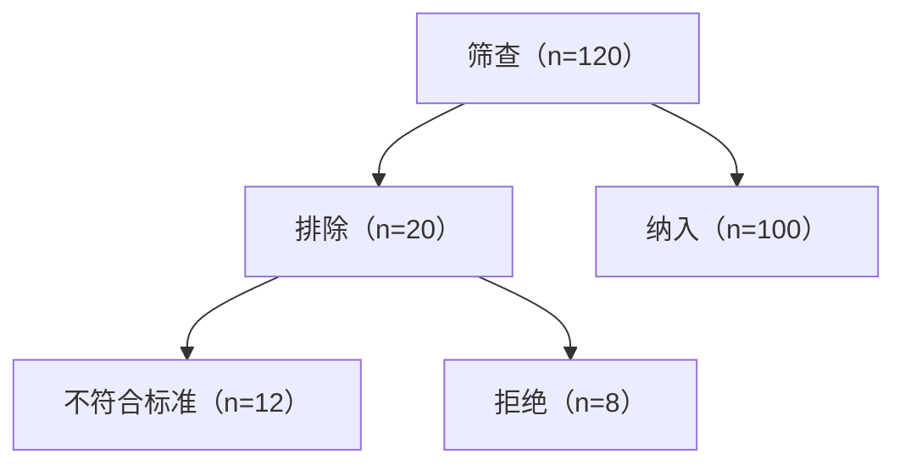

## T1｜拒稿后是否补实验，并先审结果段

**当前裁决：HOLD，暂不能据此决定补实验。**

现有信息不足以证明“值得重做”，也不足以认定稿件结果段存在具体错误。创新性评估所需的 `research-topic-selection` 未安装；而且未提供结果段、图表、数据、完整审稿意见或最近邻文献。因此以下只能列为“无法核实/待检查”，不能写成已发现的问题。

| 重点 | 状态 | 需检查内容 |
|---|---|---|
| R01 分母一致性 | 无法核实 | 纳入、排除、失败、缺失及最终分析人数能否对账，分析单位是否一致 |
| R03 数值完整性 | 无法核实 | 效应方向、单位、分母、置信区间及 P 值是否匹配 |
| R05 阴性与失败结果 | 无法核实 | 是否遗漏不利、失败或阴性结果，是否无解释地改变分母 |
| R06 分析身份 | 无法核实 | 主要、次要、探索、事后和敏感性分析是否明确区分 |
| R07 跨材料一致性 | 无法核实 | 正文、表格、图、补充材料及源数据是否一致 |
| R08 主张强度 | 无法核实 | 是否把相关写成因果、把不显著写成等效、把点估计领先写成确定优势 |
| R09 结果可追溯性 | 无法核实 | 每个结果句能否定位到方法和图表，结果段是否混入推测 |
| W02–W03 语义保真 | 无法核实 | 数值、方向、否定、限制及证据确定性是否被语言修改 |
| W04–W09 表达质量 | 无法核实 | 主语和比较对象是否明确，段落逻辑、长句、宣传性词语、术语和组名是否稳定 |

是否值得补实验，可先用以下止损门槛初筛：

- **考虑继续**：能够指出相对最近邻研究的具体、可检验缺口；新实验能直接回答审稿人的核心异议；能提供独立样本、外部验证、机制性对照或其他实质性新证据；且预先定义成功、失败及停止标准。
- **不建议仅为“显得更多”而补**：只是扩大样本但不改变证据层级；重复已知实验；新增探索性结果却无法解决原创性；关键批评涉及数据来源、设计或不可修复的信息泄漏。
- **下一步资料**：结果段及对应方法、全部图表和补充材料、样本流与分析分母、完整审稿意见、作者认为最接近的3–5篇工作，以及拟补实验的假设、对照、主要终点和停止规则。

---

## T2｜连续主要结局的 SAP 框架

该研究目标、样本和主要结局已冻结，不重新选题。没有原始数据，因此交付的是**未执行的分析方案框架**，不填写结果。若研究团队已经查看按组结局，应把 SAP 标为“结果已知后追溯制定”，不能冒充事前方案。

### 1. 版本与冻结信息

- SAP 版本、日期、负责人和批准人
- 伦理批件、方案和注册编号
- 已冻结的目标人群、纳排标准、主要结局及测量时间窗
- 是否已查看任何结局或组间结果
- 后续修改规则与偏离记录位置

### 2. 目标量

用一句话冻结：

> 在【目标人群】的【时间窗】内，比较【组别/暴露条件】，估计【连续结局及方向】的【均值差或其他预定汇总量】，以【患者/中心等独立单位】为权重目标。

同时明确：

- time zero、主要时间点、量表范围、单位及高低值含义；
- 分析单位、独立单位、重复测量、配对或聚类结构；
- 试验中五项 estimand 属性及停药、救援治疗、死亡等中间事件策略；
- 最小临床重要差异或精度目标及来源。

### 3. 主要分析

最终模型必须由设计决定：

- **平行两组、单一主要随访点且有基线测量**：预先指定 ANCOVA/线性回归，以随访结局为因变量，组别为主要解释变量，调整基线结局及少量预先确定的设计变量。报告调整均值差、95% CI 和双侧 P 值。
- **多个重复测量时间点**：考虑线性混合模型或 GEE，预先指定组别、时间及组别×时间项；主要估计量仍是冻结主要时间点的组间对比。
- **配对或单组前后设计**：估计个体差值，并使用配对方法；不能把配对观测当作独立两组。
- **中心/家庭等聚类设计**：模型或方差估计必须保留相应聚类层级。

不根据 Shapiro–Wilk 或 Levene 检验结果临时切换方法；模型选择和协变量不得按单变量 P 值筛选。

### 4. 描述与报告

- 按组报告有效独立样本数、均值和 SD；必要时补充中位数、IQR、范围及分布图。
- 明确每项分析的分母及缺失人数。
- 主要报告效应量及区间，不只报告 P 值。
- 样本量已冻结时不做 observed power；用置信区间说明现有精度。

### 5. 缺失数据

- 按组、时间和原因汇总缺失，不把缺失编码为零。
- 主策略须与 estimand 对齐；完整病例分析需要明确成立条件及人群改变。
- 若采用多重插补，应规定插补变量、层级结构、次数、诊断和合并规则。
- 设置领域可解释的 MNAR 情景或 tipping-point 敏感性分析。
- 死亡、竞争事件、中间事件和普通缺失分别处理。

### 6. 诊断和敏感性分析

- 检查残差、异方差、函数形式、极端值、影响点及模型收敛。
- 预先规定模型失败时的补救方案，例如稳健标准误或适当的重抽样；不得看结果后挑最显著方法。
- 区分同一 estimand 的稳健性分析与改变 estimand 的补充分析。
- 亚组使用预设交互项；不能以“一组显著、另一组不显著”作为亚组差异证据。

### 7. 多重性与审计

- 若只有一个主要结局、一个主要时间点和一个主要对比，可说明主要检验族仅含该对比。
- 多个主要对比或共同主要结局必须预先定义检验族及 FWER/FDR 策略。
- 固定代码版本、输入哈希、随机种子、运行命令、排除、失败、模型警告及输出版本。
- 预设结果表、效应图、Methods 文本及偏离表。

在正式冻结模型前仍需补齐：研究设计、组别数量、是否有基线值、测量时间点、随机化/聚类/配对结构和中间事件定义。

---

## T3｜单 panel 均值—置信区间折线图计划

仅有汇总列 `treatment、time、mean、lower、upper`，适合绘制“点/线＋已核置信区间”，不生成原始散点、箱线图或分布图。

| 阶段 | 执行动作 | 验收标准 |
|---|---|---|
| 输入冻结 | 记录 CSV 版本和哈希；确认列名及类型 | 文件和列映射可追溯 |
| 结构检查 | 检查每个 `treatment × time` 是否唯一，确定 time 排序 | 无重复单元；顺序有依据 |
| 数值检查 | 检查有限数值、`lower ≤ upper`、缺失与异常区间 | 不静默修正或删除；异常有记录 |
| CI 定义 | 确认区间水平和计算方法，例如 95% CI | 图注能准确说明，不把 CI 写成 SD/SE |
| 绘图 | x=`time`，y=`mean`，按 `treatment` 分线；均值用点，CI 用误差线或透明带 | 单 panel；各组编码一致 |
| 缺失处理 | 未观测时间点断线，不插值、不跨缺失连接 | 图形与原表一致 |
| 视觉设计 | 色觉友好颜色并辅以标记/线型；图例置于数据区外 | 不遮挡点、线或区间 |
| 坐标与说明 | 补齐 time 和结局单位；标注 CI 类型 | 无歧义、无夸大标题 |
| 导出计划 | 独立导出白底 RGB/LZW 800 dpi TIFF 和单页矢量 PDF | 尺寸、字体、DPI和PDF矢量对象通过检查 |
| 最终验收 | 分别打开实际 TIFF 和 PDF，核对点数、线、CI、标签和图例 | 无裁剪、重叠、错序或旧预览混用 |

当前仅完成计划，因此实际绘图、P01–P24技术检查、TIFF/PDF视觉检查均应标为“待执行”，不能声称已通过。

---

## T4｜纳排流程图

未调用统计作图技能，也未安装 `research-flow-diagrams` 或新依赖。现有数字满足：

- \(120 = 20 + 100\)
- \(20 = 12 + 8\)

可交付以下简单 Mermaid 源图：

边界：这里只核验了计数守恒；由于未提供公开来源链接，无法独立核验数字来源。当前可交付的是结构化流程图源码，不声称已完成专用流程图模块的期刊版式、可编辑矢量文件或 TIFF/PDF 验收。

---

## 实际读取的 skill / path / ref

仓库：`gongboji-cyber/Manuscript-Submission-and-Academic-Writing`  
分支：`main`  
解析到的提交：`90f43f21a58a67686cd7dae75dc8e857641900c2`

- T1 `audit-and-polish-manuscript`
  - `论文投稿前的自检/SKILL.md`
  - `论文投稿前的自检/references/checklist.md`
- T2 `guide-research-methods-statistics`
  - `方法学/统计学指导/SKILL.md`
  - `方法学/统计学指导/assets/analysis-plan-template.md`
  - `方法学/统计学指导/references/study-designs.md`
  - `方法学/统计学指导/references/statistical-methods.md`
  - `方法学/统计学指导/references/causal-and-missing.md`
- T3 `plot-research-statistics`
  - `科研统计学作图/SKILL.md`
  - `科研统计学作图/references/chart-selection.md`
  - `科研统计学作图/references/statistical-integrity.md`
  - `科研统计学作图/references/layout-and-export.md`
  - `科研统计学作图/references/checklist.md`
- T4
  - 未读取或调用未安装的 `research-flow-diagrams`
  - 未安装任何依赖，未修改文件、仓库或外部状态
