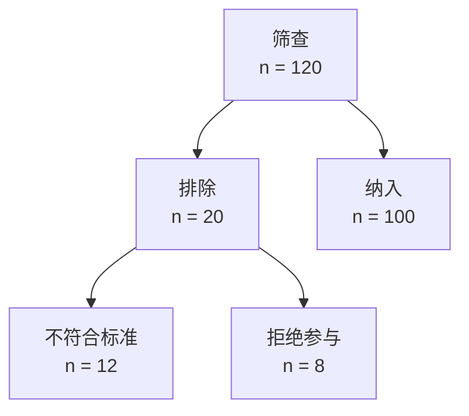

## T1｜稿件是否值得补实验，以及当前结果段审查边界

结论：目前不能据此决定是否重做为原创论文，也不能声称已经发现结果段中的具体错误。未提供结果正文、方法、图表、补充材料或数据，所有具体证据一致性与语言判断均为“无法核实”。

### 当前结果段待核清单

| 审查项 | 当前状态 | 需要核对的材料 |
|---|---|---|
| 纳入、排除、失败、缺失和最终分母能否对账 | 无法核实 | 方法、流程、结果正文、表格 |
| 主要结果是否直接回答预设主要问题 | 无法核实 | 研究目的、主要结局定义、结果段 |
| 效应方向、单位、分母、置信区间和 P 值是否一致 | 无法核实 | 结果正文、表图、统计输出 |
| 阴性、不利或失败结果是否被完整报告 | 无法核实 | 全部分析结果与排除记录 |
| 正文、图、表、补充材料中的数字是否一致 | 无法核实 | 对应版本的全部材料 |
| 是否把相关写成因果、把不显著写成等效 | 无法核实 | 具体结果句及研究设计 |
| 探索性、事后和敏感性分析是否明确标识 | 无法核实 | SAP、方法和结果正文 |
| 结果段是否混入机制推测、临床建议或宣传性措辞 | 无法核实 | 结果段原文 |

语言方面也不能在没有原文时列出实际语法问题。收到文本后应逐句检查：主语和比较对象是否明确、每项发现是否紧随数值和图表依据、术语与组名是否稳定、时点和方向是否保真、是否存在冗余或名词堆叠，以及是否越过研究设计所支持的证据强度。

### 是否值得补实验

只有同时满足下列条件，才值得把它重构为原创研究：

- 审稿意见能够转化为一个明确、可检验的新问题，而不只是“再多做几个实验”。
- 新实验会产生真正的新证据，例如独立样本验证、机制性证据、前瞻性验证或能裁决关键替代解释的对照。
- 新证据能与现有公开数据分析组成一条连贯的“问题—方法—结果—结论”链，而非附加装饰。
- 样本量、对照、重复、盲法、分析单位和失败判据可以事先确定；阴性结果同样具有解释价值。
- 时间、伦理、样本和经费成本与潜在科学增量相称。

如果只能增加重复性较低的小实验、扩大同类公开数据分析、事后寻找显著结果，或核心贡献仍只是已知标志物的再次汇总，则不建议仅为“原创论文”标签投入重做。更合理的替代方案可能是收窄主张，定位为再分析、验证性研究或方法学复核。

下一步至少需要：审稿意见全文、结果段、方法、所有表图及图注，以及作者设想补做的实验。届时才能给出逐条问题表和“补实验／重定位／停止投入”的决策。

## T2｜连续主要结局的 SAP 框架

本任务不重新选题，也不改变已冻结的目标、样本和主要结局。SAP 应注明版本、日期、冻结状态及制定时是否已经查看任何结局结果；如果已经看过结果，新增内容必须标记为追溯性修订。

### 1. 目标量卡

写成一句可执行定义：

> 在【冻结的目标人群】中，从【time zero】起至【主要评价时点】，比较【处理/暴露条件】，估计【连续结局的精确定义与方向】的【均值差或其他预定汇总量】，以【患者/中心等独立单位及权重】为目标。

若为随机试验，还需分别固定：

- 人群；
- 处理条件；
- 连续结局、量表范围、单位和主要时点；
- 停药、救援治疗、交叉、死亡等中间事件的处理策略；
- 总体汇总量，例如调整后均值差及其 95% CI。

### 2. 分析人群和数据规则

- 定义主要分析集；若有符合方案集，仅作为支持性分析，不能按结果决定。
- 明确独立单位、随机化单位，以及重复测量、中心或家庭等聚类结构。
- 固定结局计算规则、量表方向、时间窗和基线定义。
- 数据错误按可追溯规则更正；离群值不自动删除。
- 报告各阶段人数、主要结局有效分母和缺失原因。

### 3. 主分析模型

应根据既定设计预先择一写死：

| 设计结构 | 推荐主分析框架 | 主要报告 |
|---|---|---|
| 平行两组、单一随访时点且有基线值 | ANCOVA/线性回归：随访结局对组别、基线值及预设协变量建模 | 调整后均值差、95% CI、双侧 P 值 |
| 多个随访时点 | 重复测量混合模型，预设组别、时间及交互；主要对比锁定在主要时点 | 主要时点组间差及 95% CI |
| 单组或严格配对前后设计 | 配对差值或相应配对模型 | 平均变化及 95% CI |
| 中心/簇随机或明显聚类 | 混合模型或适用的 GEE，并处理小簇数问题 | 边际或条件效应，明确解释 |
| 观察性研究 | 预设混杂因素的回归模型 | 条件关联；除非识别假设充分，否则不作因果表述 |

协变量应依据设计和领域知识预设，不能用单变量 P 值筛选或逐步回归决定。连续协变量不应默认二分；必要的非线性形式和交互须事先说明。

### 4. 缺失、诊断和敏感性分析

- 分变量、组别和时间报告缺失数量、比例、原因及联合模式。
- 区分普通缺失与死亡、停药、救援治疗等中间事件。
- 主策略可采用与分析模型兼容的多重插补，但必须说明 MAR 假设、插补变量、层级结构、插补次数和合并方法。
- 进行有临床含义的 MNAR 情景分析，如 delta 调整或 tipping-point；完整病例分析只有在目标量与假设可辩护时才作为敏感性分析。
- 检查残差、功能形式、异方差、影响点、收敛及随机效应可识别性。诊断异常触发预先规定的稳健模型或变换敏感性分析，不按显著性挑结果。
- 区分“同一 estimand 的稳健性分析”和“改变 estimand 的补充分析”。

### 5. 推断和报告

- 若只有一个主要结局和一个主要比较，可采用双侧 α=0.05；存在多个主要比较时须预先定义检验族和多重性控制。
- 同时报效应量、95% CI、单位、方向和有效分母；不只报告 P 值。
- 结合预先给定的最小有意义差异解释精度和临床意义。
- 沿用原立项中的样本量依据并记录参数来源；不使用事后 observed power 解释结果。
- 记录软件、版本、代码、随机种子、输入和输出版本，以及所有 SAP 偏离及其发生时间。

目前没有原始数据，因此交付的是“未执行 SAP 框架”，不能填写任何模型结果或诊断结论。

## T3｜单 panel 均值—置信区间折线图计划

首选图形为：每个 `treatment` 一条线，`time` 为横轴，`mean` 为点和连线，`lower`–`upper` 用置信带或竖向区间表示。现有数据只有汇总值，因此不绘制箱线图、散点分布，也不反推伪造个体数据。

### 执行前核验

- 每个 `treatment × time` 组合应唯一；重复行不得静默平均。
- `mean`、`lower`、`upper` 必须为有限数值，且 `lower ≤ upper`。
- 明确 `time` 的真实顺序，避免按字符串错误排序。
- 确认置信水平、区间计算方法和分析单位；仅凭这五列无法证明区间确为 95% CI。
- 缺失时间点应断线，不插值、不跨缺失连接。
- 确认坐标单位、治疗组显示顺序及是否存在预定参考线。

### 绘制规范

- 用颜色加线型/点形进行冗余编码，保证灰度下仍可区分。
- 每个时间点显示均值标记；CI 带重叠严重时改用细区间线。
- 图例放在不遮挡曲线和区间的位置，必要时置于绘图区外但保持在画布内。
- 不新增显著性检验、星号、平滑曲线或组间推断。
- 单 panel 独立输出；初始尺寸可按约 89 × 70 mm 设置，再依标签长度调整。

### 验收标准

- 抽查图中均值和上下界与 CSV 逐行一致。
- 时间顺序、组别编码、缺失断线和坐标单位正确。
- 标题、刻度、图例和 CI 无裁剪、重叠或遮挡。
- 若实际执行，输出白底 RGB/LZW 800 dpi TIFF及单页矢量 PDF，并分别重新打开检查尺寸、字体、线条和区间。
- 保存独立可运行代码、参数、输入版本或哈希及重运行命令。

由于未提供 CSV 实际内容，本次只完成执行与验收计划，没有声称已经生成或检查图形。

## T4｜纳排流程图

已给数字内部守恒：排除原因 `12 + 8 = 20`，且 `120 − 20 = 100`。

当前没有专门的流程图模块，且不安装新依赖，因此可交付的是上述可渲染流程图及人数守恒核对；未生成投稿用 TIFF、PDF 或可编辑矢量文件。另因未提供公开来源的 URL 或原始记录，我只能核验这些数字的内部一致性，不能独立认证其外部出处或完整筛查过程。
